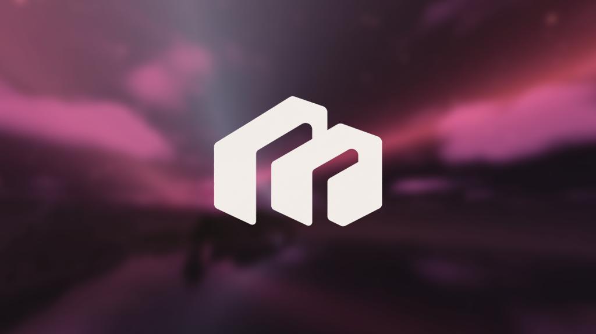
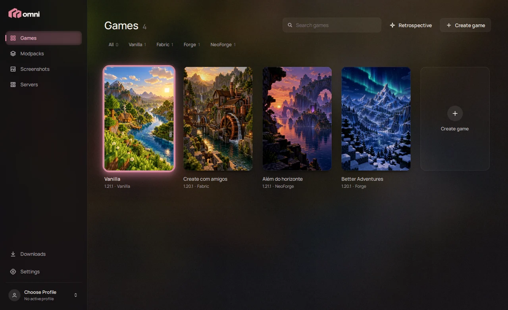
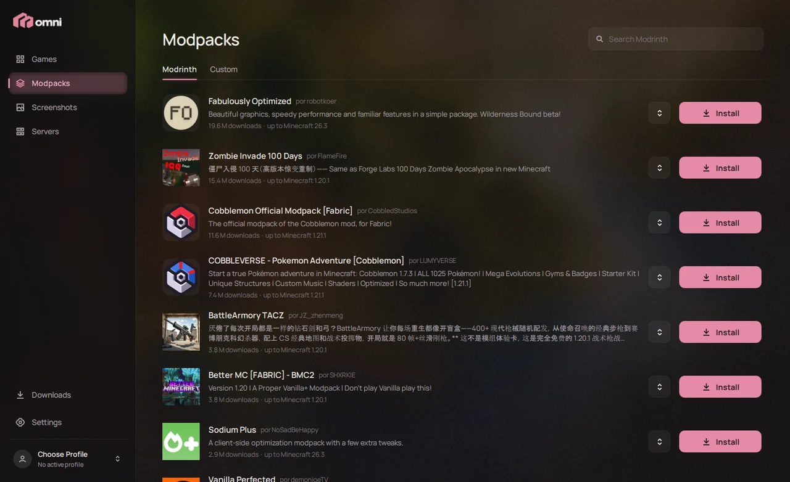
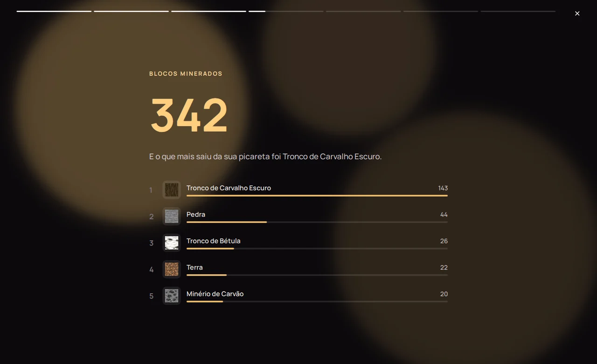
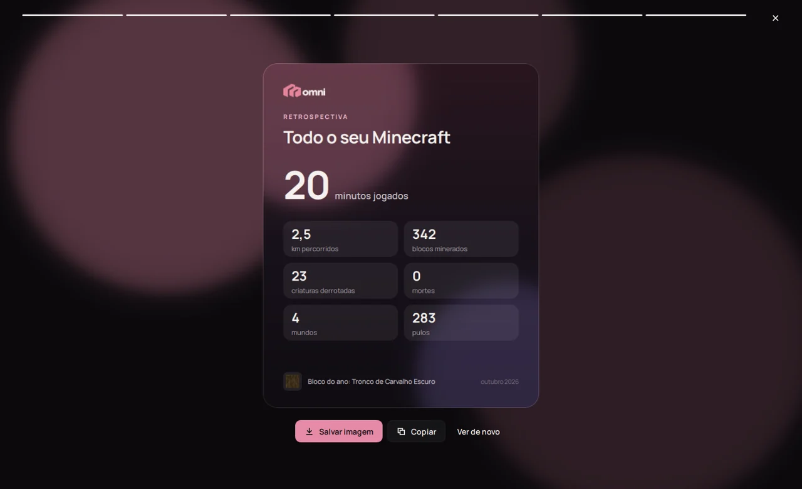

<p align="center">
  
</p>

<p align="center">
  <b>A calm, beautiful launcher for Minecraft: Java Edition.</b><br>
  Your game installations as a library of covers, mods and modpacks one click away,<br>
  and everything you need to play with friends.
</p>

<p align="center">
  <a href="https://github.com/GuardaChuva22/OmniLauncher/releases/latest/download/OmniLauncher-Setup.exe"><b>Download for Windows</b></a>
  &nbsp;·&nbsp;
  <a href="README.pt-BR.md">Leia em português</a>
</p>

---



## Why OmniLauncher

Most launchers feel like settings panels. OmniLauncher starts from the other end: what it feels like to open it and pick something to play. Each installation (a "game") has its own cover, version, loader, mods and worlds. Hovering a cover fills the window with its colours, pressing Play turns into a short transition, and the launcher steps aside to the tray while you play. It comes back when you close the game.

It is a personal project, built in C++ and Qt Quick, and shared with friends.

## What it does

**Library**
- Create games with any Minecraft version (releases, snapshots, old betas and alphas) on **Vanilla, Fabric, Forge or NeoForge**, with the loader version you choose.
- Every game is isolated: its own mods, configs, worlds, memory and resolution. Duplicate one to experiment safely.
- Playtime per game, a crash diagnosis that explains what went wrong, world backups, and a screenshot gallery for all games.
- Your preferred Minecraft options (FOV, sensitivity, volumes, controls…) are applied to every new game, including a full key-binding editor.

**Mods and modpacks**
- Search and install mods, shaders and resource packs from **Modrinth**, with their dependencies, filtered to the game's version and loader.
- Install Modrinth modpacks as new games, switch their version, and update installed mods in one click.
- A download centre shows everything in progress and what finished.



**Playing together**
- **Shared modpacks.** Turn one of your games into a modpack, get a six-letter code and send it to friends. They join with the code and receive every new version you publish, as an incremental update. No accounts needed.
- **Servers.** Host a dedicated server from any game, with the same version, loader and mods (client-only mods are left out automatically). It has a live console, player management, world backups and a form for `server.properties`. An optional connector gives the server a public address without port forwarding.
- **Discord Rich Presence** shows what you are playing.

**Retrospectiva**
- A recap of your Minecraft, built from the statistics the game already keeps: hours played, favourite world, distance travelled, blocks mined, creatures and more. It ends on a card you can save or copy.

<p align="center">
  
  
</p>

**Details**
- An opening title, soft glows and micro-animations, and quiet interface sounds (each can be turned off; "Reduce motion" removes animations).
- Self-updates from this repository's releases.
- Interface in Brazilian Portuguese.

## Microsoft account, privacy and Minecraft

OmniLauncher signs in with **Microsoft accounts**, the official way to play Minecraft: Java Edition.

- **Sign-in happens in your browser.** The launcher uses the OAuth 2.0 authorization code flow with PKCE and a loopback redirect, under its own Azure application. It never sees or stores your Microsoft password.
- **What the sign-in is used for.** The chain Microsoft → Xbox Live → XSTS → Minecraft services is used only to confirm that the account owns Minecraft, read the player's name and skin, and start the game.
- **What is stored.** Only the Microsoft refresh token, locally, in the Windows Credential Manager. Minecraft access tokens stay in memory and are never written to logs.
- **Game files are never redistributed.** The game, its libraries and assets, and the Java runtimes are all downloaded from Mojang's official servers and checked against their published hashes. Loaders come from their official sources (Fabric Meta, the Forge and NeoForge Maven repositories), and mods from Modrinth.
- **Servers follow the EULA.** Hosting a server requires the player to accept the [Minecraft EULA](https://aka.ms/MinecraftEULA) first.
- **No tracking.** There is no analytics or telemetry. The launcher only talks to:
  - Microsoft, Xbox Live and Minecraft services;
  - Mojang's download servers and the loader sources above;
  - Modrinth;
  - GitHub, for updates;
  - OmniLauncher Cloud, only when you share or follow a modpack. It stores mod lists and config archives, nothing personal.
  - Two optional features talk to their own services: Discord Rich Presence goes through your local Discord app, and the server connector uses [e4mc](https://e4mc.link).

**Offline profiles** are local player names for single-player and LAN play. They become available only after a Microsoft account that owns Minecraft: Java Edition has been added to the launcher. They do not authenticate with Minecraft services and cannot join servers that require a Minecraft account.

> NOT AN OFFICIAL MINECRAFT PRODUCT. NOT APPROVED BY OR ASSOCIATED WITH MOJANG OR MICROSOFT.

## Install

Download **[OmniLauncher-Setup.exe](https://github.com/GuardaChuva22/OmniLauncher/releases/latest/download/OmniLauncher-Setup.exe)** and run it.
- It installs for your Windows user only, so it never asks for administrator rights, and adds a Start menu shortcut.
- Prefer not to install? The [release page](https://github.com/GuardaChuva22/OmniLauncher/releases/latest) also has a zip: extract it and open `OmniLauncher.exe`.

Windows may warn that the app is from an unknown publisher, because the executable is not code-signed yet. Choose **More info → Run anyway**.

Your games, worlds and settings live in `%APPDATA%\OmniLauncher` and stay there if you uninstall.

## Build from source

Requirements: Windows 10/11, Visual Studio 2022 Build Tools with C++, and PowerShell.

```powershell
powershell -ExecutionPolicy Bypass -File scripts/setup-qt.ps1   # downloads Qt 6.8.3 into .tools/
powershell -ExecutionPolicy Bypass -File scripts/build.ps1
powershell -ExecutionPolicy Bypass -File scripts/run.ps1
```

`scripts/package.ps1` builds the release: the zip, and the installer when [Inno Setup 6](https://jrsoftware.org/isinfo.php) is installed. Every push to `main` does the same on GitHub Actions and refreshes the release.

| Folder | What's inside |
| --- | --- |
| `src/app` | Startup and the library model (games, profiles, settings) |
| `src/core` | Game installation and launch, loaders, Modrinth, Microsoft sign-in, servers, shared packs, updates |
| `qml` | The whole interface (Qt Quick) |
| `cloud` | OmniLauncher Cloud, a Cloudflare Worker for shared modpacks |
| `installer` | The Inno Setup script |
| `docs` | [Shared and custom modpacks](docs/CUSTOM-PACKS.md), and the original [design brief](docs/DESIGN.md) |

## Credits

- Built with [Qt 6](https://www.qt.io) (LGPLv3), with the [Manrope](https://github.com/sharanda/manrope) typeface (SIL Open Font License).
- Mods and modpacks come from [Modrinth](https://modrinth.com).
- Interface sounds were synthesized with [earshot](https://github.com/Leonxlnx/earshot).
- The cover art and the brand identity are original to this project.
