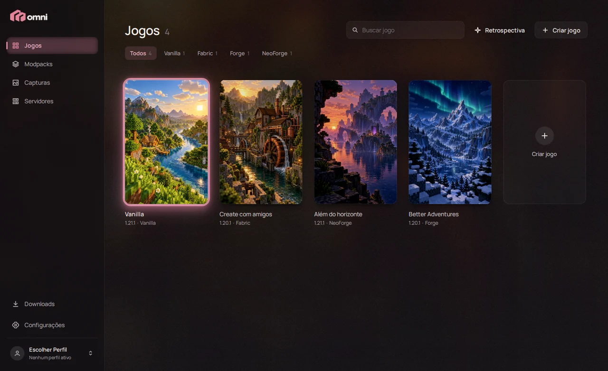
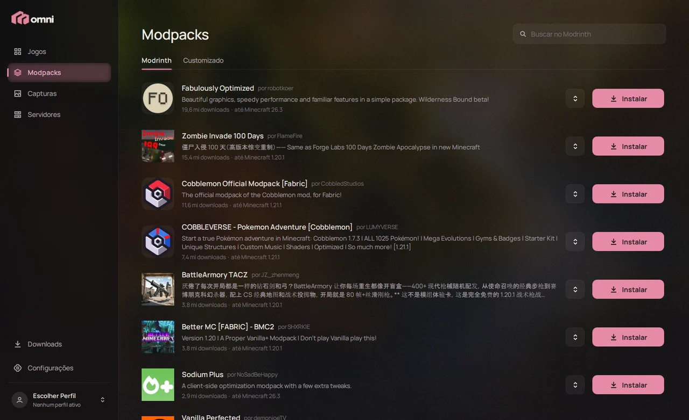

<p align="center">
  
</p>

<p align="center">
  <b>Um launcher calmo e bonito para Minecraft: Java Edition.</b><br>
  Suas instalações como uma biblioteca de capas, mods e modpacks a um clique,<br>
  e tudo o que você precisa para jogar com os amigos.
</p>

<p align="center">
  <a href="https://github.com/GuardaChuva22/OmniLauncher/releases/latest/download/OmniLauncher-Setup.exe"><b>Baixar para Windows</b></a>
  &nbsp;·&nbsp;
  <a href="README.md">Read in English</a>
</p>

---



## Por que o OmniLauncher

A maioria dos launchers parece um painel de configurações. O OmniLauncher começa pelo outro lado: a sensação de abrir e escolher o que jogar. Cada instalação (um "jogo") tem capa, versão, loader, mods e mundos próprios. Passar o mouse numa capa enche a janela com as cores dela, apertar Jogar vira uma transição curta, e o launcher vai para a bandeja enquanto você joga. Ele volta quando você fecha o jogo.

É um projeto pessoal, feito em C++ e Qt Quick, compartilhado com amigos.

## O que ele faz

**Biblioteca**
- Crie jogos com qualquer versão do Minecraft (releases, snapshots, betas e alphas antigas) em **Vanilla, Fabric, Forge ou NeoForge**, com a versão do loader que quiser.
- Cada jogo é isolado: mods, configs, mundos, memória e resolução próprios. Duplique um para testar sem medo.
- Tempo de jogo por jogo, diagnóstico de travamentos que explica o que deu errado, backup de mundos e uma galeria com as capturas de todos os jogos.
- Suas opções preferidas do Minecraft (FOV, sensibilidade, volumes, controles…) entram em todo jogo novo, com um editor completo de teclas.

**Mods e modpacks**
- Busque e instale mods, shaders e resource packs do **Modrinth**, com as dependências, filtrados pela versão e pelo loader do jogo.
- Instale modpacks do Modrinth como jogos novos, troque a versão deles e atualize os mods instalados num clique.
- Uma central de downloads mostra o que está baixando e o que já terminou.



**Jogar junto**
- **Modpacks compartilhados.** Transforme um dos seus jogos num modpack, receba um código de seis letras e mande para os amigos. Eles entram com o código e recebem cada versão nova que você publicar, como atualização incremental. Sem criar conta.
- **Servidores.** Hospede um servidor dedicado a partir de qualquer jogo, com a mesma versão, o mesmo loader e os mesmos mods (os mods só de cliente ficam de fora sozinhos). Tem console ao vivo, gerenciamento de jogadores, backup do mundo e um formulário para o `server.properties`. Um conector opcional dá ao servidor um endereço público sem abrir portas no roteador.
- **Discord Rich Presence** mostra o que você está jogando.

**Retrospectiva**
- Um resumo do seu Minecraft, feito com as estatísticas que o jogo já guarda: horas jogadas, mundo favorito, distância percorrida, blocos minerados, criaturas e mais. Termina num cartão para salvar ou copiar.

<p align="center">
  
  
</p>

**Detalhes**
- Uma abertura com o título, glows suaves, microanimações e sons de interface bem baixos (dá para desligar cada um; "Reduzir movimento" tira as animações).
- Atualiza sozinho pelas releases deste repositório.
- **Português do Brasil e inglês.** O launcher segue o idioma do Windows e dá pra trocar em Configurações a qualquer momento, sem reiniciar.

## Conta Microsoft, privacidade e Minecraft

O OmniLauncher entra com **contas Microsoft**, o jeito oficial de jogar Minecraft: Java Edition.

- **O login acontece no seu navegador.** O launcher usa o fluxo OAuth 2.0 de código de autorização com PKCE e redirecionamento local, com o aplicativo Azure próprio dele. Ele nunca vê nem guarda a sua senha da Microsoft.
- **Para que serve o login.** A cadeia Microsoft → Xbox Live → XSTS → serviços do Minecraft só é usada para confirmar que a conta tem o Minecraft, ler o nome e a skin do jogador e iniciar o jogo.
- **O que fica guardado.** Só o refresh token da Microsoft, no próprio PC, no Gerenciador de Credenciais do Windows. Os tokens de acesso do Minecraft ficam só na memória e nunca vão para os logs.
- **Nenhum arquivo do jogo é redistribuído.** O jogo, as bibliotecas, os assets e o Java vêm dos servidores oficiais da Mojang e são conferidos pelos hashes publicados. Os loaders vêm das fontes oficiais (Fabric Meta e os repositórios Maven do Forge e do NeoForge), e os mods, do Modrinth.
- **Servidores seguem o EULA.** Para hospedar um servidor, o jogador precisa aceitar antes o [EULA do Minecraft](https://aka.ms/MinecraftEULA).
- **Sem rastreamento.** Não há analytics nem telemetria. O launcher só fala com:
  - Microsoft, Xbox Live e serviços do Minecraft;
  - os servidores de download da Mojang e as fontes de loaders acima;
  - o Modrinth;
  - o GitHub, para atualizações;
  - a OmniLauncher Cloud, só quando você compartilha ou segue um modpack. Ela guarda listas de mods e arquivos de config, nada pessoal.
  - Dois recursos opcionais falam com serviços próprios: o Discord Rich Presence passa pelo app do Discord no seu PC, e o conector de servidor usa o [e4mc](https://e4mc.link).

**Perfis offline** são nomes de jogador locais para jogar sozinho e em LAN. Eles só ficam disponíveis depois que uma conta Microsoft com o Minecraft: Java Edition é adicionada ao launcher. Não se autenticam nos serviços do Minecraft e não entram em servidores que exigem conta do Minecraft.

> NÃO É UM PRODUTO OFICIAL DO MINECRAFT. NÃO É APROVADO PELA MOJANG OU PELA MICROSOFT NEM ASSOCIADO A ELAS.

## Instalar

Baixe o **[OmniLauncher-Setup.exe](https://github.com/GuardaChuva22/OmniLauncher/releases/latest/download/OmniLauncher-Setup.exe)** e abra.
- Ele instala só para o seu usuário do Windows, então nunca pede administrador, e cria um atalho no Menu Iniciar.
- Prefere não instalar? A [página da release](https://github.com/GuardaChuva22/OmniLauncher/releases/latest) também tem um zip: extraia e abra o `OmniLauncher.exe`.

O Windows pode avisar que o app é de um editor desconhecido, porque o executável ainda não tem assinatura digital. Clique em **Mais informações → Executar assim mesmo**.

Seus jogos, mundos e configurações ficam em `%APPDATA%\OmniLauncher` e continuam lá se você desinstalar.

## Compilar

Requisitos: Windows 10/11, Visual Studio 2022 Build Tools com C++, e PowerShell.

```powershell
powershell -ExecutionPolicy Bypass -File scripts/setup-qt.ps1   # baixa o Qt 6.8.3 em .tools/
powershell -ExecutionPolicy Bypass -File scripts/build.ps1
powershell -ExecutionPolicy Bypass -File scripts/run.ps1
```

O `scripts/package.ps1` gera a release: o zip, e o instalador quando o [Inno Setup 6](https://jrsoftware.org/isinfo.php) está instalado. Cada push na `main` faz o mesmo no GitHub Actions e atualiza a release.

| Pasta | O que tem |
| --- | --- |
| `src/app` | Inicialização e o modelo da biblioteca (jogos, perfis, ajustes) |
| `src/core` | Instalar e iniciar o jogo, loaders, Modrinth, login Microsoft, servidores, packs compartilhados, atualizações |
| `qml` | Toda a interface (Qt Quick) |
| `cloud` | A OmniLauncher Cloud, um Cloudflare Worker para os modpacks compartilhados |
| `installer` | O script do Inno Setup |
| `assets/i18n` | Traduções: o código é escrito em português e o `en.json` leva cada texto para o inglês. O `scripts/i18n_extract.py` lista os textos ainda sem tradução |
| `docs` | [Modpacks compartilhados e customizados](docs/CUSTOM-PACKS.md), e o [documento de design](docs/DESIGN.md) original |

## Créditos

- Feito com [Qt 6](https://www.qt.io) (LGPLv3) e a fonte [Manrope](https://github.com/sharanda/manrope) (SIL Open Font License).
- Mods e modpacks vêm do [Modrinth](https://modrinth.com).
- Os sons da interface foram sintetizados com o [earshot](https://github.com/Leonxlnx/earshot).
- As artes das capas e a identidade visual são originais do projeto.
